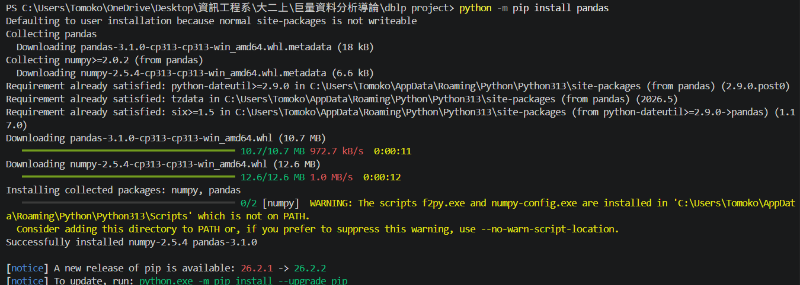
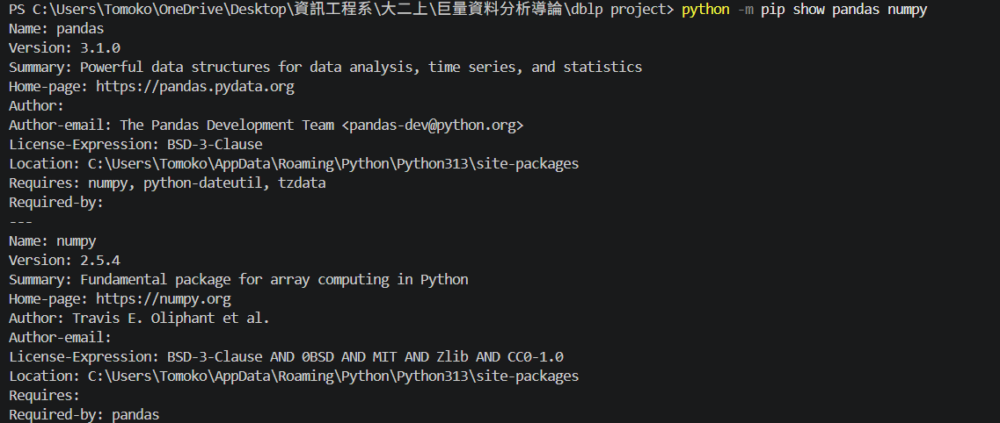
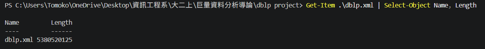
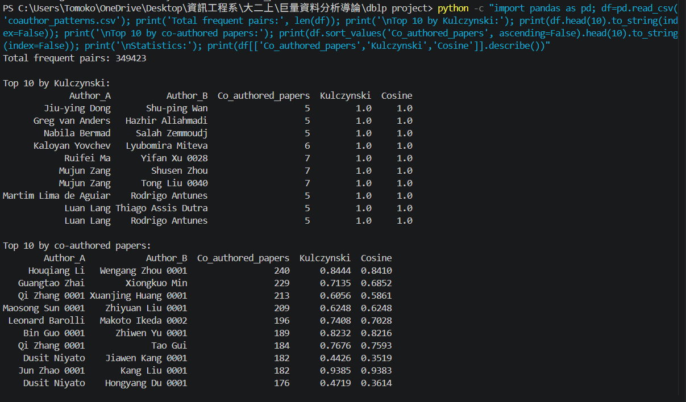
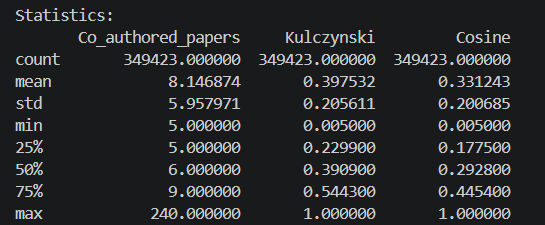
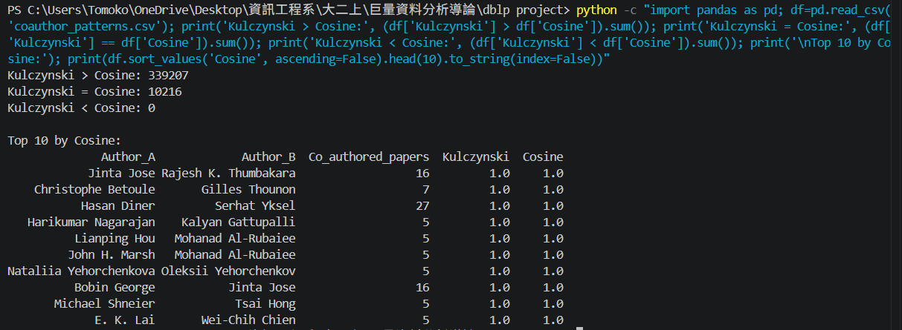

# DBLP Co-Author Pattern Mining

A Python-based project for parsing large-scale DBLP XML datasets, extracting co-author relationships, and mining closely-correlated co-author pairs using null-invariant measures (Kulczynski and Cosine).

---

## 📖 Project Overview

This project analyzes collaboration patterns between researchers in the DBLP dataset. The goal is to identify author pairs who frequently publish together and evaluate how closely they collaborate. Instead of relying only on the number of co-authored papers, this project also considers the proportion of publications shared by each author.

**Workflow:**

`dblp.xml` → `dblp.py` → `coauthors.txt` → `minecoauthor.py` → `coauthor_patterns.csv`

---

## 🛠️ Requirements and Installation

Make sure you have **Python 3** installed on your system. 

Install the required Python packages by running the following command in your terminal:

```bash
python -m pip install pandas
```

Although only `pandas` was explicitly installed, `numpy` was also installed as a dependency. The following screenshot shows the successful installation of `pandas` and `numpy`.



The following command was used to verify that both packages were available in the Python environment:

```bash
python -m pip show pandas numpy
```

This command confirmed that:
- `pandas` version: **3.1.0**
- `numpy` version: **2.5.4**



---

## 📥 Dataset Source & Download

The raw DBLP XML dataset (`dblp.xml`) is required to run the extraction script. You can obtain it using the official sources below:
* **Direct XML Dump Download:** [https://dblp.org/xml/](https://dblp.org/xml/)
* **Download & Parsing FAQ Guide:** [https://dblp.org/faq/How+can+l+download+the+whole+dblp+dataset.html](https://dblp.org/faq/How+can+l+download+the+whole+dblp+dataset.html)

The XML file was saved locally as `dblp.xml` in the project directory. The following PowerShell command was used to verify that the dataset file existed and to inspect its size:

```bash
Get-Item .\dblp.xml | Select-Object Name, Length
```

The output confirmed that:
- File name: `dblp.xml`
- File size: **5,380,520,125 bytes**
 


---

## 🚀 How to Run the Project (Step-by-Step Guide)

### Step 1: Extracting and Cleaning the DBLP Dataset
1. Place the raw DBLP XML dataset (`dblp.xml`) and the extraction script (`dblp.py`) in the same working directory.
2. Run the extraction script to stream the dataset, handle special XML entities, and generate the cleaned transactions file:

```bash
python dblp.py
```

* **Sample Input:** `dblp.xml` (Raw DBLP XML dump file)
* **Generated Output:** `coauthors.txt` (Cleaned transaction lines containing co-authors per paper)

---

### Step 2: Mining Close Collaborators
1. Ensure `coauthors.txt` and the mining script (`minecoauthor.py`) are in the same folder.
2. Execute the mining script to process transactions, calculate individual frequencies, and compute correlation measures:

```bash
python minecoauthor.py
```

* **Sample Input:** `coauthors.txt`
* **Generated Output:** `coauthor_patterns.csv` (CSV file containing ranked closely-correlated co-author pairs)

### Step 3 — Inspect pair rankings and statistics (recorded command)

```powershell
python -c "import pandas as pd; df=pd.read_csv('coauthor_patterns.csv'); print('Total frequent pairs:', len(df)); print('\nTop 10 by Kulczynski:'); print(df.head(10).to_string(index=False)); print('\nTop 10 by co-authored papers:'); print(df.sort_values('Co_authored_papers', ascending=False).head(10).to_string(index=False)); print('\nStatistics:'); print(df[['Co_authored_papers','Kulczynski','Cosine']].describe())"
```

### Step 4 — Compare correlation measures (recorded command)

```powershell
python -c "import pandas as pd; df=pd.read_csv('coauthor_patterns.csv'); print('Kulczynski > Cosine:', (df['Kulczynski'] > df['Cosine']).sum()); print('Kulczynski == Cosine:', (df['Kulczynski'] == df['Cosine']).sum()); print('Kulczynski < Cosine:', (df['Kulczynski'] < df['Cosine']).sum()); print('\nTop 10 by Cosine:'); print(df.sort_values('Cosine', ascending=False).head(10).to_string(index=False))"
```

The next two sections interpret the **recorded outputs**. The included screenshots show the results inspection, not the console output of the two initial script runs.

---

## 📁 File Structure

```text
DBLP-project/
├── dblp.py               # Script for parsing and cleaning dblp.xml
├── minecoauthor.py       # Script for mining frequent patterns & correlation
├── dblp.xml              # Raw dataset (Input)
├── coauthors.txt         # Cleaned transactions (Intermediate Output)
└── coauthor_patterns.csv # Final ranked output patterns (Generated Output)
```

---

## QUESTIONS

### A) Propose a method to efficiently mine a set of coauthor relationships that are closely correlated (e.g. often coauthoring papers together). ###

To efficiently mine close co-author relationships from the massive DBLP dataset (>5 GB), we can apply a streaming-based association analysis approach:

Efficient Streaming Extraction: Because the standard XML parser struggles with the large file size and special entity errors, we use a line-by-line streaming parser with Regular Expressions (re) to extract author names from (article) and (inproceedings) tags safely and quickly, writing them into a structured text file (coauthors.txt).

Minimum Support Pruning: To eliminate random pairings or rare collaborations, we apply a minimum support threshold (e.g., min_support = 5). Pairs with fewer joint papers than this threshold are pruned immediately.

Pair Generation & Correlation Computation: Using combination tools (itertools.combinations), we group authors by paper, generate unique pairs of co-authors, count individual and joint occurrences, and compute null-invariant correlation measures (Kulczynski and Cosine). The final results are exported to coauthor_patterns.csv.





### B) Based on the mining results and the pattern evaluation measures discussed in this chapter, discuss which measure may convincingly uncover close collaboration patterns better than others. ###

#### **1. Why Standard Measures (Confidence & Lift) Fail**

* **Confidence:** It only measures the relationship in one direction ($P(B|A)$). It checks how often Author B appears when Author A publishes, but ignores the perspective from Author B.
* **Lift:** It tries to measure how much two authors depend on each other, but it relies heavily on the total number of papers in the entire dataset.
* **The Main Issue (Null-Transactions):** In a massive dataset like DBLP, millions of author pairs **never** write papers together (zero-frequency pairs). Standard measures like **Confidence** and **Lift** are not *null-invariant*. The huge number of non-collaborating authors skews the math, leading to misleading correlation scores.

---

#### **2. Why Kulczynski (and Cosine) is Better**

To solve this issue, we must use **Null-Invariant Measures** like **Kulczynski** and **Cosine**.

* **Null-Invariance:** These measures completely ignore author pairs who have never collaborated. They focus only on papers that authors actually published together, making them immune to dataset sparsity.
* **Why Kulczynski is the Best Choice:** Kulczynski calculates the average of bidirectional conditional probabilities:
  $$\text{Kulc}(A, B) = \frac{1}{2} (P(A|B) + P(B|A))$$
  This provides a balanced evaluation. For example, if a senior professor publishes 100 papers a year and a student publishes 5 papers (all 5 with that professor), Kulczynski correctly identifies their strong bond without being penalized by the professor's high publication count.



---

#### **Conclusion**
**Confidence** and **Lift** cannot be used reliably because they get heavily distorted by the massive number of unshared zero counts. **Kulczynski** is the most convincing measure because it ignores zero-collaborations and fairly evaluates two-way relationships between authors.
